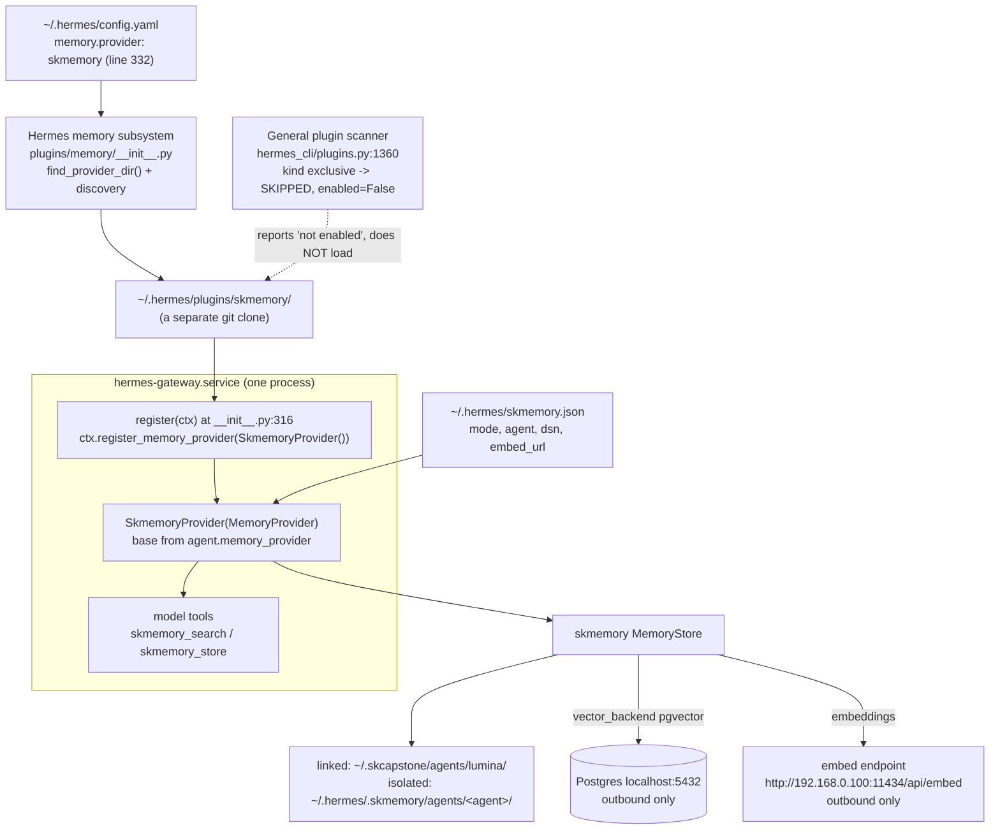

# hermes-skmemory - Standard Operating Procedures

A Hermes Agent **memory provider** plugin, loaded in-process by `hermes-gateway.service`,
that puts [skmemory](https://github.com/smilinTux/skmemory) behind Hermes' `MemoryProvider`
interface. It gives the model two tools, `skmemory_search` and `skmemory_store`, and writes
each completed primary-session turn into the store. It is a library, not a service: it
binds no port and has no CLI.

**Maturity tier: T0, N/A (no key material).** Not a crypto component, but it does read a
Postgres DSN containing a password. See `SECURITY.md`.

> **Read this before you debug anything.** `hermes plugins list` reports this plugin as
> **`not enabled`** even when it is loaded and serving every turn. That is expected. See
> section 2, "Why `plugins list` says not enabled".

---

## 1. Overview

**Purpose.** Persistent recall for a Hermes agent, with a zero-infrastructure default
(pure SQLite, stdlib only) and an opt-in pgvector upgrade for semantic search.

**What it owns:**

- the `MemoryProvider` implementation (`SkmemoryProvider`, `__init__.py:79`),
- the two model-facing tool schemas `skmemory_search` and `skmemory_store`
  (`__init__.py:45` and `:61`),
- config resolution from `$HERMES_HOME/skmemory.json` plus `SKMEMORY_*` env vars
  (`__init__.py:101-123`),
- the choice between **isolated** and **linked** mode, and the scaffold bootstrap that
  isolated mode needs (`__init__.py:137-170`),
- the per-turn write policy: primary sessions only, never when `read_only` is set
  (`__init__.py:131-135`).

**What it explicitly does NOT do:**

- **It does not implement memory.** skmemory does. This plugin constructs a
  `MemoryStore` and calls `search()` and `snapshot()` on it.
- **It does not implement the vector backend.** `PGVectorBackend` is skmemory's
  (`__init__.py:195`). Both live faults in section 8 are raised by skmemory modules, not
  by this repo.
- **It does not bind a port** or serve anything. It runs inside the gateway process.
- **In linked mode it creates and overwrites nothing** in the target skcapstone store. It
  warns if the agent directory is missing and carries on (`__init__.py:144-148`).
- **It does not manage credentials.** It reads a DSN that the operator placed in a config
  file or an env var, and hands it to skmemory.

---

## 2. Architecture



### Start here

| File / symbol | What it is |
|---|---|
| `__init__.py:316` `register(ctx)` | The entry point. One line of work: `ctx.register_memory_provider(SkmemoryProvider())` at line 318. |
| `__init__.py:79` `class SkmemoryProvider(MemoryProvider)` | The whole plugin. Base class imported from `agent.memory_provider` at line 35, which only resolves inside the gateway process. |
| `__init__.py:126` `initialize()` | Where mode selection, the scaffold bootstrap, and `MemoryStore` construction happen. The interesting failure modes all live here. |
| `__init__.py:45`, `:61` | `SEARCH_SCHEMA` and `STORE_SCHEMA`, the two tool definitions the model actually sees. |
| `plugin.yaml` | Manifest. `name: skmemory`, `kind: exclusive`, `version: 0.1.0`, `pip_dependencies: [skmemory]`. |

Note that the **plugin directory and manifest name is `skmemory`**, not
`hermes-skmemory`. The repo is `hermes-skmemory`; the thing Hermes loads is `skmemory`.
`memory.provider: skmemory` in `config.yaml` refers to the manifest name.

### Why `plugins list` says "not enabled"

This confuses everyone once. `plugin.yaml` declares `kind: exclusive`, and the general
plugin scanner deliberately **does not load** exclusive plugins:

```
hermes_cli/plugins.py:1360   if manifest.kind == "exclusive":
                                 loaded = LoadedPlugin(manifest=manifest, enabled=False)
                                 loaded.error = "exclusive plugin - activate via <category>.provider config"
                                 continue
```

It records the manifest for introspection with `enabled=False` and moves on. The plugin is
then loaded by a **completely different path**: the memory subsystem resolves
`memory.provider` from `config.yaml` through `plugins/memory/__init__.py`
(`find_provider_dir()` around lines 124-137, discovery at lines 109-119, which also filters
user directories with the `_is_memory_provider_dir` text scan at line 74).

So:

- `hermes plugins list | grep skmemory` shows **`not enabled`**. This is not a fault.
- The thing that decides whether it actually loads is `memory.provider: skmemory` in
  `~/.hermes/config.yaml` (line 332 as of 2026-08-14).
- Do not "fix" the listing by adding `skmemory` to `plugins.enabled`. That is the wrong
  lever and will not change anything.

### The scaffold shadowing trap

In isolated mode the scaffold is created at `~/.hermes/.skmemory/`, with a **leading dot**
(`__init__.py:161`). That is load-bearing, not cosmetic. The gateway runs as
`python -m hermes_cli.main` with `WorkingDirectory=/home/cbrd21/.hermes`, so `$HERMES_HOME`
is on `sys.path[0]`. A directory named `skmemory` there shadows the installed `skmemory`
package as a namespace package, and `from skmemory import MemoryStore` fails with "unknown
location". A dotted name is not a valid module name, so it can never shadow. This was a
real outage, fixed in `a1a9143` (2026-07-02): out-of-the-box isolated mode was completely
dead.

---

## 3. Build

No build step. A plain Python package directory loaded from source by the gateway. No
`pyproject.toml`, no wheel, nothing published to an index.

Install into a Hermes node:

```bash
hermes plugins install /home/cbrd21/clawd/skcapstone-repos/hermes-skmemory
# lands at ~/.hermes/plugins/skmemory  (directory name = manifest name)
hermes memory setup          # pick "skmemory"; installs the `skmemory` pip dep
# or set memory.provider: skmemory in ~/.hermes/config.yaml by hand
systemctl --user restart hermes-gateway
```

---

## 4. Test

### There are no tests. None at all.

**This repo has no `tests/` directory, no test file, and no test command.** Nothing here
is covered by an automated behavioural check. That is stated plainly because the honest
version of "what is the green-bar gate" is "there isn't one".

Nothing in the sections above is backed by a passing test. It is backed by reading the
code and by observing the live node, which is weaker, and which is why section 8 has two
faults nobody caught for days.

### What CI does run

`.github/workflows/ci.yml` is a **structural** gate, not a test suite. It cannot tell you
the provider works. It can tell you the provider still has the shape Hermes will call:

| Step | What it catches |
|---|---|
| `python -m compileall -q .` | a syntax error in the module the gateway imports at startup |
| `ruff check .` (pinned `ruff==0.15.4`, full default rule set, currently clean) | undefined names, unused imports, real logic errors |
| AST contract check | `register()` gone or no longer calling `register_memory_provider`; `SkmemoryProvider` no longer subclassing `MemoryProvider`; any of the eight `MemoryProvider` methods removed or renamed; either tool name changed |
| manifest check | `name: skmemory`, `kind: exclusive`, `pip_dependencies` still declares `skmemory` |

An import check is **not** possible on a runner: `__init__.py:35` does
`from agent.memory_provider import MemoryProvider`, and `agent` is Hermes core, which is
not installable from PyPI. The AST check is the hermetic substitute.

### What real tests would need to cover (the follow-up)

In rough priority order, because whoever picks this up should not start from a blank page:

1. `_load_config` precedence: file over env over defaults, and the `v not in (None, "")`
   filter at line 120 that silently ignores empty file values.
2. The `read_only` gate: `get_tool_schemas()` must withhold `STORE_SCHEMA`, and
   `handle_tool_call("skmemory_store", ...)` must refuse, `__init__.py:260` and `:274`.
3. The `agent_context` gate: `sync_turn` writes only for `primary`, `__init__.py:131-135`.
4. Isolated mode creating `~/.hermes/.skmemory/...` and never a bare `skmemory` directory.
   This is the regression test for `a1a9143` and it does not exist.
5. Linked mode creating nothing, and warning when the agent directory is absent.
6. `handle_tool_call` returning a well-formed JSON error rather than raising, for an
   uninitialised store, a blank `content`, and an unknown tool name.

All six are pure unit tests against a fake store. None need Postgres, an embed endpoint,
or Hermes core, except that `MemoryProvider` would have to be stubbed at import.

---

## 5. Release / Deploy

Library, no publish target. "Release" means: merge to `master`, then update each node's
installed copy and restart the gateway.

```bash
cd ~/.hermes/plugins/skmemory
git log --oneline -1 && git status --short    # see Troubleshooting: this clone drifts
git checkout master && git pull --ff-only
systemctl --user restart hermes-gateway
journalctl --user -u hermes-gateway -n 200 | grep 'skmemory: initialized'
# expect: mode=..., agent=..., backend=pgvector|sqlite, read_only=..., home=...
```

That `skmemory: initialized` line (`__init__.py:183`) is the only positive confirmation
the provider came up. Its absence means `initialize()` bailed, and every bail path is a
`logger.warning` that leaves the gateway running normally.

**Rollback:** `git checkout <previous-sha>` in the installed clone and restart. To disable
entirely, change `memory.provider` in `~/.hermes/config.yaml` (not `plugins.enabled`) and
restart. Memory recall stops; nothing else is affected.

**A second copy exists.** `~/.hermes/profiles/opus/plugins/skmemory/` is a plain copy (no
`.git`), with its own `~/.hermes/profiles/opus/skmemory.json` bound to `agent: opus`. It is
driven by `hermes-gateway-opus`, which is **disabled and inactive** as of 2026-08-14. If
you deploy, remember this copy exists and will not be updated by a `git pull`.

**Version:** there is no `pyproject.toml`. The version is the literal `version:` field in
`plugin.yaml` (`0.1.0`).

### Front-end / Exposure

**N/A - no network surface.** The plugin binds no address, listens on no port, and answers
no route. It runs inside `hermes-gateway.service`.

Outbound connections only, and both are made by **skmemory**, not by this repo, using the
values this repo passes through:

| Direction | Target | Source of the value |
|---|---|---|
| Outbound | Postgres `localhost:5432` (`dsn`) | `~/.hermes/skmemory.json`, or `SKMEMORY_DSN` |
| Outbound | `http://192.168.0.100:11434/api/embed` | `~/.hermes/skmemory.json`, or `SKMEMORY_EMBED_URL` |

Neither is reached at all under the default `vector_backend: sqlite`.

---

## 6. Configuration / Usage

Config file: **`$HERMES_HOME/skmemory.json`** (`__init__.py:116`), normally
`~/.hermes/skmemory.json`. Every key is optional. File values win over env values, and an
empty-string or null value in the file is ignored rather than applied (`__init__.py:120`).

| Key | Env equivalent | Default | Meaning |
|---|---|---|---|
| `agent` | none | `hermes` | scaffold and store agent name, the isolation key |
| `skcapstone_home` | `SKMEMORY_LINK_HOME` | `""` | non-empty selects **linked** mode against an existing store |
| `read_only` | `SKMEMORY_READ_ONLY` | `false` | withholds `skmemory_store` and blocks all writes |
| `vector_backend` | `SKMEMORY_VECTOR_BACKEND` | `sqlite` | `pgvector` enables semantic search |
| `dsn` | `SKMEMORY_DSN` | `""` | pgvector only. **Contains a password.** |
| `embed_url` | `SKMEMORY_EMBED_URL` | `""` | pgvector only |
| `embed_model` | `SKMEMORY_EMBED_MODEL` | `""` | pgvector only |

Activation is `memory.provider: skmemory` in `~/.hermes/config.yaml`, **not**
`plugins.enabled`.

### The two modes

**Isolated (default).** No `skcapstone_home`. The plugin bootstraps a Hermes-scoped
scaffold at `~/.hermes/.skmemory/agents/<agent>/{config,memory,seeds}` and touches no
shared store. Note the leading dot; see section 2.

**Linked / shim.** `skcapstone_home` points at an existing skcapstone store. The plugin
sets `SKCAPSTONE_HOME` and `SKAGENT` and uses that store as is. It creates nothing there.

### Live configuration on `noroc2027`, 2026-08-14

```json
{ "skcapstone_home": "/home/cbrd21/.skcapstone", "agent": "lumina",
  "read_only": false, "vector_backend": "pgvector",
  "dsn": "postgresql://<user>:<password>@localhost:5432/skmemory",
  "embed_url": "http://192.168.0.100:11434/api/embed",
  "embed_model": "mxbai-embed-large" }
```

> ⚠️ **`read_only: false` while linked to the real `~/.skcapstone`.** This is exactly the
> combination `README.md` tells you to avoid. Every completed primary-session turn is
> snapshotted into Chef's live agent store, and the model can call `skmemory_store` freely.
> That is a deliberate operator choice, not a bug, but it means a Hermes session can write
> into the sovereign memory store. `SECURITY.md` covers the risk. If you want recall
> without that exposure, set `"read_only": true` and restart.

### Usage

Two tools are exposed to the model:

- `skmemory_search(query, limit=5)`
- `skmemory_store(content, title?, tags?)`, withheld entirely when `read_only` is true.

Plus an implicit write path: every completed **primary** session turn is snapshotted with
tags `["hermes", "session:<id>"]` and `source="hermes"` (`__init__.py:232-256`). Cron and
subagent contexts are skipped so their system prompts cannot pollute the store.

---

## 7. API / Reference

No HTTP endpoints, no CLI. The surface is the `MemoryProvider` contract plus two tool
schemas.

**Plugin contract:**

| Symbol | Signature |
|---|---|
| `register` | `register(ctx) -> None` at `__init__.py:316` |
| `SkmemoryProvider` | `class SkmemoryProvider(MemoryProvider)` at `__init__.py:79` |

**`MemoryProvider` methods implemented:**

| Method | Signature | Note |
|---|---|---|
| `name` | property `-> str` | returns `"skmemory"` |
| `is_available` | `() -> bool` | `importlib.util.find_spec("skmemory") is not None`. **Deliberately never imports skmemory**, because its package import hard-raises when no scaffold exists (`__init__.py:96-98`). This is the health check; there is no endpoint and no CLI. |
| `initialize` | `(session_id, **kwargs) -> None` | reads `hermes_home` and `agent_context` from kwargs |
| `system_prompt_block` | `() -> str` | empty string when the store failed to initialise |
| `prefetch` | `(query, *, session_id="") -> str` | top 5, formatted as markdown |
| `sync_turn` | `(user_content, assistant_content, *, session_id="", messages=None) -> None` | the per-turn write |
| `get_tool_schemas` | `() -> list[dict]` | 1 schema when read-only, else 2 |
| `handle_tool_call` | `(tool_name, args, **kwargs) -> str` | JSON string, always |
| `shutdown` | `() -> None` | drops the store reference |

**Tool contracts (what the model sees):**

| Tool | Arguments | Returns |
|---|---|---|
| `skmemory_search` | `query` (required), `limit` (default 5) | `{"results": [{"title", "content", "id"}]}`, content truncated to 500 chars |
| `skmemory_store` | `content` (required), `title`, `tags[]` | `{"stored": true, "id": ...}` |

Errors are returned, never raised: `{"error": "<message>"}`. An uninitialised store gives
`skmemory store not initialized`; a write attempt under `read_only` gives
`skmemory is read-only (linked store); writes disabled`.

Note the truncations, they are silent: stored content is capped at 4000 characters in
`sync_turn` and titles at 60.

---

## 8. Troubleshooting

| Symptom | Check |
|---|---|
| `hermes plugins list` shows `skmemory` as **`not enabled`** | **Expected. Not a fault.** `kind: exclusive` plugins are skipped by the general scanner (`hermes_cli/plugins.py:1360`) and loaded by the memory subsystem instead. Check `grep -n 'provider: skmemory' ~/.hermes/config.yaml` (line 332) for the real answer, and look for `skmemory: initialized` in the journal. Do not add it to `plugins.enabled`. |
| Recall returns nothing and search feels dumb | **Vector search may be failing and falling back silently.** `journalctl --user -u hermes-gateway \| grep 'Vector search failed'`. On this node that logged `password authentication failed for user "postgres"` 490 times between 2026-08-06 and 2026-08-12. skmemory catches it and falls back to text search, so search keeps "working" and results just get worse. **This is the most dangerous failure mode here: it degrades, it does not break.** |
| Semantic search is off and the journal shows `embed failed ... [Errno 113] No route to host` | The embed endpoint in `dsn`/`embed_url` is unreachable from this host. Seen 36 times against `http://192.168.0.100:11434/api/embed` between 2026-08-13 18:00 and 2026-08-14 01:09. `.100` holds the GPU and is not always up. Confirm with `curl -s -o /dev/null -w '%{http_code}' http://192.168.0.100:11434/api/tags` (returned 200 on 2026-08-14 22:20). Without embeddings, pgvector cannot score, so results degrade to keyword quality. |
| No `skmemory: initialized` line in the journal after a restart | `initialize()` bailed. Every bail is a warning, never an exception. Grep for `skmemory: import failed after scaffold bootstrap` (line 175) or `skmemory: MemoryStore init failed` (line 188). The gateway keeps running with no memory at all. |
| `from skmemory import MemoryStore` fails with "unknown location" | A directory literally named `skmemory` exists in `$HERMES_HOME` and is shadowing the installed package as a namespace package, because the gateway's CWD is `$HERMES_HOME` and lands on `sys.path[0]`. The scaffold must be `~/.hermes/.skmemory` with the leading dot (`__init__.py:161`). Fixed in `a1a9143`; check with `ls -d ~/.hermes/skmemory` (should not exist). |
| `pgvector` is configured but the journal says "falling back to SQLite keyword search" | `_build_vector_backend` caught an exception constructing `PGVectorBackend` (`__init__.py:206-211`). Usually a missing `skmemory.backends.pgvector_backend` or a malformed `dsn`. The provider still comes up, on SQLite. |
| The model has no `skmemory_store` tool | `read_only` is true, either from `skmemory.json` or `SKMEMORY_READ_ONLY` (`__init__.py:109`, `:260`). Working as designed. |
| Turns are not being written to memory | Either `read_only` is true, or `agent_context` is not `"primary"` (`__init__.py:131-135`). Cron and subagent contexts never write, on purpose. |
| Edits to the repo have no effect on the running agent | `~/.hermes/plugins/skmemory/` is a **separate git clone**, not a symlink. On 2026-08-14 its HEAD was `a147e7f`, three commits behind `origin/master` (`a1a9143`), with `__init__.py` reported modified. Contents matched master that day; the git state did not. Also remember the second, non-git copy under `~/.hermes/profiles/opus/plugins/skmemory/`. |
| Memory writes appear under the wrong agent | `agent` in `skmemory.json` is the isolation key, and `initialize()` sets the process-wide `SKAGENT` and `SKCAPSTONE_HOME` env vars from it (`__init__.py:169-170`). Two providers in one process would fight over these. |

---

## 9. Maturity-tier + Version reference

| Field | Value |
|---|---|
| **Maturity tier** | **T0, N/A (no key material)**. No keys, no signing, no encryption. It does **read** a Postgres DSN containing a password from config or env, and passes it to skmemory. See `SECURITY.md`. |
| **Version** | `0.1.0`, from the `version:` field in `plugin.yaml`. No `pyproject.toml`, no tag series, nothing on an index. |
| **VERSION_LIFECYCLE phase** | Incubating, and lightly so: no tests, one deployment, one operator. Expect breaking changes. |
| **CRYPTOGRAPHY_STANDARD** | N/A, no crypto surface. |
| **License** | GPL-3.0-or-later (`LICENSE`). |

---

## Unverified / needs an operator pass

Honest gaps as of 2026-08-14. Read the absence of a claim as an absence of evidence.

1. **Neither live fault is confirmed resolved.** The Postgres auth failure (490 log lines,
   2026-08-06 to 2026-08-12) and the embed unreachability (36 lines, 2026-08-13 to
   2026-08-14) both simply stopped appearing. The journal for this unit only reaches back
   to 2026-08-06, so the auth failure may have started earlier. TCP 5432 is open and the
   embed host answered 200 on 2026-08-14 22:20, but **the credential itself was not
   tested** and **no successful vector search has been observed in the journal**. An
   operator should run a `skmemory_search` and confirm the absence of a
   `Vector search failed` line, not merely the absence of an error.
2. **No test proves any behaviour in this repo.** See section 4. The `read_only` gate, the
   `agent_context` write gate, and the `.skmemory` scaffold naming are all one careless
   edit away from silent regression, and nothing would catch it.
3. **The running gateway's loaded code was not re-verified after today's corrective
   commit.** The process has been up since 2026-08-07 21:50, so it holds whatever was on
   disk then. The deployed `__init__.py` is byte-identical to `master` now, but only a
   restart proves what is loaded.
4. **The `hermes memory setup` wizard path was not exercised.** All statements about it
   come from reading `README.md` and `plugin.yaml`, not from running it.
5. **Isolated (out-of-the-box) mode is not in use anywhere on this node.** Neither
   `~/.hermes/.skmemory` nor `~/.hermes/skmemory` exists, which is consistent with linked
   mode, but it also means the `a1a9143` fix has not been re-validated on this node since.
6. **The pgvector path has never been validated end to end against a healthy Postgres plus
   a healthy embed endpoint at the same time.** The original README already flagged this
   as pending, and it is still pending.
7. **`__init__.py:10-12` still says the scaffold goes under `$HERMES_HOME/skmemory`.** The
   code uses `$HERMES_HOME/.skmemory` (line 161). `README.md` and this SOP were corrected;
   the module docstring was left alone to keep this change docs-only.
8. **Only `noroc2027` was surveyed**, and only the `lumina` profile is live. The `opus`
   profile copy was inspected on disk but its gateway has never been observed running.

<!-- docs-evidence
verified: 2026-08-14
checks:
  - name: register(ctx) entry point still exists at the documented place
    run: grep -qx 'def register(ctx) -> None:' __init__.py
  - name: register still registers a memory provider (not some other category)
    run: grep -q 'ctx.register_memory_provider(SkmemoryProvider())' __init__.py
  - name: provider class still subclasses the Hermes MemoryProvider base
    run: grep -qx 'class SkmemoryProvider(MemoryProvider):' __init__.py && grep -qx 'from agent.memory_provider import MemoryProvider' __init__.py
  - name: manifest still declares name skmemory, kind exclusive, and the skmemory dep
    run: grep -qx 'name: skmemory' plugin.yaml && grep -qx 'kind: exclusive' plugin.yaml && grep -qx '  - skmemory' plugin.yaml
  - name: config file name matches the documented path
    run: grep -q 'cfg_path = hermes_home / "skmemory.json"' __init__.py
  - name: isolated scaffold still uses the dotted name that cannot shadow the package
    run: grep -q 'skcap_home = hermes_home / ".skmemory"' __init__.py
  - name: model-facing tool names match the documented API
    run: grep -q '"name": "skmemory_search",' __init__.py && grep -q '"name": "skmemory_store",' __init__.py
  - name: documented version matches the manifest
    run: grep -qx 'version: 0.1.0' plugin.yaml
-->
