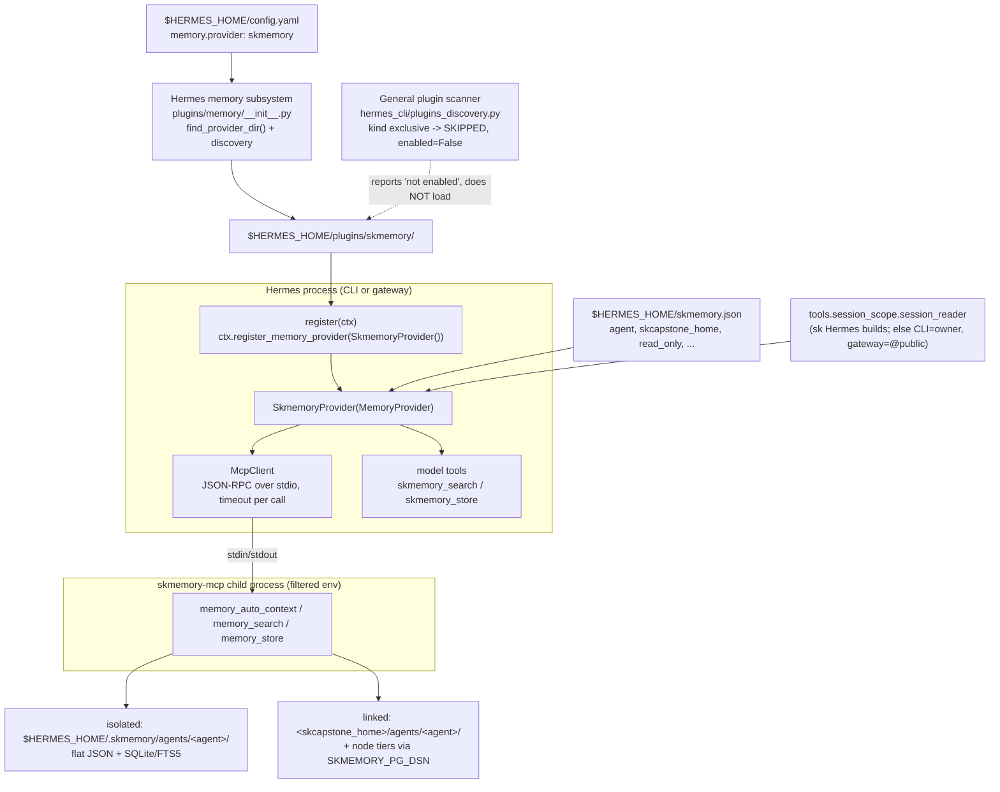

# hermes-skmemory - Standard Operating Procedures

A Hermes Agent **memory provider** plugin that puts [skmemory](https://github.com/smilinTux/skmemory)
behind Hermes' `MemoryProvider` interface **without importing it**: it runs the
`skmemory-mcp` stdio server as a child process and speaks MCP JSON-RPC to it. It gives the
model two tools, `skmemory_search` and `skmemory_store`, injects relevant memories before
each turn, and writes each completed owner turn into the store. It binds no port and has
no CLI.

**Maturity tier: T0, N/A (no key material).** Not a crypto component. In linked mode it may
pass a Postgres DSN (which contains a password) to the child. See `SECURITY.md`.

> **Read this before you debug anything.** `hermes plugins list` reports this plugin as
> **`not enabled`** even when it is loaded and serving every turn. That is expected. See
> section 2, "Why `plugins list` says not enabled".

---

## 1. Overview

**Purpose.** Persistent recall for a Hermes agent, with a zero-infrastructure default (a
private store on skmemory's local tier: flat JSON plus SQLite/FTS5, offline) and a linked
mode that serves an existing skcapstone agent with whatever tiers its node has.

Where it fits: the SK estate runs the "enterprise" edition, where skmemory is its own
service reached by MCP or the CLI. This plugin is the "inside Hermes" path, used by the
per-user sksidekick edition and by anyone installing from the Hermes plugin catalog.

**What it owns:**

- the `MemoryProvider` implementation (`class SkmemoryProvider` in `__init__.py`),
- a minimal MCP stdio client (`class McpClient`): one child per provider instance, one
  request in flight at a time, a per-call timeout, restart of a dead child on the next call,
- the two model-facing tool schemas `SEARCH_SCHEMA` (`skmemory_search`) and
  `STORE_SCHEMA` (`skmemory_store`),
- config resolution from `$HERMES_HOME/skmemory.json` plus a few env fallbacks
  (`_load_config`), and the `hermes memory setup` hooks (`get_config_schema`, `save_config`),
- locating the server (`_find_mcp_command`),
- the choice between **isolated** and **linked** mode and the environment the child gets
  (`initialize`, `_child_env`),
- the per-turn scope (`_session_reader`) and the write policy: primary context, owner turn,
  not `read_only`.

**What it explicitly does NOT do:**

- **It does not implement memory, search ranking or storage tiers.** skmemory does, in its
  own process. The plugin calls the server tools `memory_auto_context`, `memory_search`
  and `memory_store`.
- **It never imports skmemory**, and declares no `pip_dependencies`. skmemory is installed
  outside Hermes (`uv tool install skmemory` or `pipx install skmemory`).
- **It does not bind a port** or serve anything. The child is spoken to over its stdio only.
- **In linked mode it creates nothing** in the target skcapstone store. It warns if the agent
  directory is missing and carries on.
- **It does not manage credentials.** It passes an operator-provided DSN to the child.

---

## 2. Architecture



### Start here

| File / symbol | What it is |
|---|---|
| `__init__.py` `register(ctx)` | The entry point. One line of work: `ctx.register_memory_provider(SkmemoryProvider())`. |
| `__init__.py` `class SkmemoryProvider(MemoryProvider)` | The provider. Base class from `agent.memory_provider` (Hermes core). |
| `__init__.py` `initialize()` / `_child_env()` | Mode selection, store scaffold, server lookup, and the environment the child gets. |
| `__init__.py` `class McpClient` | The stdio transport: `initialize` handshake, `tools/call`, timeout, restart. |
| `__init__.py` `_session_reader()` | Who the turn is for. `None` means owner. |
| `plugin.yaml` | Manifest. `name: skmemory`, `kind: exclusive`, `version: 0.2.0`, `requires_hermes: ">=0.21.6"`, no `pip_dependencies`. |

Note that the **plugin directory and manifest name is `skmemory`**, not
`hermes-skmemory`. The repo is `hermes-skmemory`; the thing Hermes loads is `skmemory`.
`memory.provider: skmemory` in `config.yaml` refers to the manifest name.

### Why `plugins list` says "not enabled"

This confuses everyone once. `plugin.yaml` declares `kind: exclusive`, and the general
plugin scanner deliberately **does not load** exclusive plugins. In current Hermes that is
`hermes_cli/plugins_discovery.py`:

```
if manifest.kind == "exclusive":
    ... "exclusive plugin - activate via <category>.provider config" ...
```

It records the manifest with `enabled=False` and moves on. The plugin is then loaded by a
**different path**: the memory subsystem resolves `memory.provider` from `config.yaml`
through `plugins/memory/__init__.py` (`find_provider_dir()`, plus discovery that filters
user directories with the `_is_memory_provider_dir` text scan).

So:

- `hermes plugins list | grep skmemory` shows **`not enabled`**. This is not a fault.
- What decides whether it loads is `memory.provider: skmemory` in `$HERMES_HOME/config.yaml`.
- Do not "fix" the listing by adding `skmemory` to `plugins.enabled`. That is the wrong
  lever and will not change anything.

### The child process and its environment

One `skmemory-mcp` child per provider instance, so one per Hermes profile. It is started
lazily on the first memory call, with `cwd=$HERMES_HOME` and stderr discarded. The client
does the MCP `initialize` handshake (protocol `2025-06-18`), then sends `tools/call`
requests one at a time.

Before the child starts, every inherited variable starting with `SKMEMORY_`, `SKCAPSTONE_`,
`SKAGENT` or `SK_DEFAULT_AGENT` is removed. Then the plugin sets `SKCAPSTONE_HOME`,
`SKAGENT`, `SKMEMORY_AGENT` and `SKCAPSTONE_AGENT` (all to the configured `agent`), and:

- **isolated:** `SKMEMORY_HOME=$HERMES_HOME/.skmemory/agents/<agent>`, and no DSN unless
  `dsn` is set in the config file;
- **linked:** no `SKMEMORY_HOME`, and `SKMEMORY_PG_DSN` from Hermes's own environment is
  passed through (or config `dsn` wins if set).

Everything else in Hermes's environment is inherited as is (see `SECURITY.md`).

### The dotted store directory

The isolated store is `$HERMES_HOME/.skmemory/`, with a **leading dot**. In v0.1, which
imported skmemory in-process, a directory named `skmemory` there shadowed the package
(`$HERMES_HOME` was on `sys.path[0]`) and killed isolated mode outright (`a1a9143`). v0.2
never imports skmemory, but the name is kept so nothing else that does import it can be
shadowed, and so existing v0.1 isolated stores are found in place.

---

## 3. Build

No build step. A plain Python package directory loaded from source by Hermes. No
`pyproject.toml`, no wheel, nothing published to an index.

Install into a Hermes:

```bash
uv tool install skmemory           # or: pipx install skmemory  (puts skmemory-mcp on PATH)
hermes plugins install https://github.com/smilinTux/hermes-skmemory
# lands at $HERMES_HOME/plugins/skmemory  (directory name = manifest name)
hermes memory setup                # pick "skmemory"
# or set memory.provider: skmemory in $HERMES_HOME/config.yaml by hand
```

Then restart Hermes.

---

## 4. Test

```bash
python3 -m pip install pytest
python3 -m pytest -q               # from the repo root
```

`conftest.py` stubs `agent.memory_provider` when Hermes core is not importable, so the
suite runs without hermes-agent. Two files:

- **`tests/test_provider.py`** (20 tests) drives the provider against
  `tests/fake_skmemory_mcp.py`, a stand-in MCP server that logs every call and the env it
  was started with. Covers: owner prefetch through `memory_auto_context` with no reader;
  per-turn `memory_store` (short-term, tags `hermes` and `session:<id>`); the store and
  search tools (limit capped at 20); non-owner readers (`channel:...`, `@public`) searching
  under their reader and never writing; a scope error failing closed to `@public`; missing
  session scope with and without `assume_owner` and `_HERMES_GATEWAY`; `read_only`; a
  non-primary context never writing; the isolated and linked child environments; no server
  meaning unavailable; `save_config` keeping only known keys; a hung server timing out; a
  dead server restarted on the next call; `queue_prefetch` consumed once; keyword
  extraction.
- **`tests/test_integration.py`** (1 test) runs the real `skmemory-mcp` in isolated mode:
  store, recall, the sensitive-tag filter on auto-injected context, and files on disk under
  `.skmemory/agents/<agent>/memory`. **Skipped** when no `skmemory-mcp` is found
  (`SKMEMORY_MCP_BIN`, `PATH`, `~/.skenv/bin`), which is the case in CI.

### What CI runs

`.github/workflows/ci.yml`:

| Step | What it catches |
|---|---|
| `python -m compileall -q .` | a syntax error in the module Hermes imports at startup |
| `ruff check .` (pinned `ruff==0.15.4`, default rule set) | undefined names, unused imports, real logic errors |
| AST contract check | `register()` gone or no longer calling `register_memory_provider`; `SkmemoryProvider` no longer subclassing `MemoryProvider`; a required provider method removed or renamed; any `import skmemory`; either tool name changed |
| manifest check | `name: skmemory`, `kind: exclusive`, a `version:`, and **no** `skmemory` in `pip_dependencies` |
| `python -m pytest -q` | the provider behaviour above (integration test skips) |

The green bar for a merge is all five steps green. The integration test is the only one
that touches real skmemory; run it locally before a release.

---

## 5. Release / Deploy

Plugin, no publish target beyond the git repo. "Release" means: bump `version:` in
`plugin.yaml` (and `clientInfo.version` in `McpClient._start`), add a `CHANGELOG.md` entry,
merge to `master`, then update each installed copy and restart Hermes.

```bash
cd "$HERMES_HOME/plugins/skmemory"
git log --oneline -1 && git status --short    # see what is actually there first
git checkout master && git pull --ff-only
# restart Hermes (e.g. systemctl --user restart hermes-gateway)
journalctl --user -u hermes-gateway -n 200 | grep 'skmemory: ready'
# expect: skmemory: ready (mode=..., agent=..., read_only=..., server=...)
```

That `skmemory: ready` line is the only positive confirmation the provider came up. Its
absence means `initialize()` did not find `skmemory-mcp` (a warning, Hermes runs on with no
memory). The line does not prove the child works: it starts on the first call, and a broken
child shows up as empty recall and tool errors (section 8).

Upgrading skmemory itself is separate: `uv tool upgrade skmemory` (or `pipx upgrade
skmemory`). The next child start picks it up; restart Hermes to force one.

**Rollback:** `git checkout <previous-sha>` in the installed copy and restart. Going back to
v0.1 also needs skmemory inside Hermes's venv and the old config keys. To disable entirely,
set `memory.provider` to something else (or `''`) in `config.yaml`, not `plugins.enabled`,
and restart. Memory recall stops; nothing else is affected.

**Profiles:** each Hermes profile has its own `$HERMES_HOME`, its own installed copy, its
own `skmemory.json` and its own child. Updating one does not update the others.

**Version:** there is no `pyproject.toml`. The version is the literal `version:` field in
`plugin.yaml` (`0.2.0`).

### Front-end / Exposure

**N/A - no network surface.** The plugin binds no address, listens on no port, and answers
no route. It talks to its child over pipes. Any outbound connection (Postgres, an embedding
endpoint) is made by **skmemory** in the child, from skmemory's own config and the DSN this
plugin passes through. Isolated mode with no `dsn` makes none.

---

## 6. Configuration / Usage

Config file: **`$HERMES_HOME/skmemory.json`**. Every key is optional. File values win over
env fallbacks, and an empty-string or null value in the file is ignored rather than applied.

| Key | Env fallback | Default | Meaning |
|---|---|---|---|
| `agent` | none | `hermes` | store name (isolated) or agent name (linked), the isolation key |
| `skcapstone_home` | `SKMEMORY_LINK_HOME` | `""` | non-empty selects **linked** mode against an existing skcapstone home |
| `read_only` | `SKMEMORY_READ_ONLY` | `false` | withholds `skmemory_store` and blocks all writes |
| `mcp_command` | `SKMEMORY_MCP_BIN` | `PATH`, then `~/.local/bin`, `~/.skenv/bin` | path to `skmemory-mcp` |
| `dsn` | none | `""` | sets `SKMEMORY_PG_DSN` for the child. **Contains a password.** In linked mode Hermes's own `SKMEMORY_PG_DSN` is passed through when this is empty. |
| `assume_owner` | `SKMEMORY_ASSUME_OWNER` | `false` | Hermes without session scopes: treat every turn as the owner's (single-user installs only) |
| `timeout` | none | `20` | seconds per MCP call |

`hermes memory setup` prompts for `agent`, `skcapstone_home`, `read_only` and
`assume_owner` (`get_config_schema`); `save_config` writes only known keys (those four plus
`mcp_command` and `timeout`).

Removed in 0.2.0, now ignored: `vector_backend`, `embed_url`, `embed_model`, and env
`SKMEMORY_VECTOR_BACKEND`, `SKMEMORY_DSN`, `SKMEMORY_EMBED_*`. Search tiers belong to
skmemory's own configuration.

Activation is `memory.provider: skmemory` in `$HERMES_HOME/config.yaml`, **not**
`plugins.enabled`.

### The two modes

**Isolated (default).** No `skcapstone_home`. The plugin creates
`$HERMES_HOME/.skmemory/agents/<agent>/config/skmemory.yaml` (an empty `{}` if absent) and
points the child at that store with `SKMEMORY_HOME`. Local tier only, offline. Covered by
`hermes backup`, since it lives under `$HERMES_HOME` (`backup_paths()` returns nothing
extra).

**Linked.** `skcapstone_home` (with `~` expanded) points at an existing skcapstone home, and
`agent` names the agent under `agents/`. The child serves that store with the node's tiers.
The plugin creates nothing there. Pair with `read_only: true` unless writes are intended;
see `SECURITY.md`.

Example linked config (placeholders):

```json
{ "skcapstone_home": "~/.skcapstone", "agent": "myagent", "read_only": true }
```

### Who the turn is for

- sk Hermes builds: `tools.session_scope.session_reader()`; `None` is the owner.
- Stock Hermes: CLI is the owner; a process with `_HERMES_GATEWAY=1` is `@public`, unless
  `assume_owner` is set.
- Any error: `@public`.

Non-owner turns pass `reader` to `memory_auto_context` and `memory_search`, and never write.

### Usage

Two tools are exposed to the model:

- `skmemory_search(query, limit=5)`, limit capped at 20, server tool `memory_search`.
- `skmemory_store(content, title?, tags?)`, server tool `memory_store`, withheld entirely
  when `read_only` is true.

Plus two implicit paths:

- **Recall:** `prefetch` (and `queue_prefetch` in the background) extracts up to 8 content
  words from the user message and calls `memory_auto_context` with a token budget of 800.
  Results come back as a "Relevant memories" markdown block. In owner turns the server drops
  sensitive-tagged rows from this path.
- **Per-turn write:** each completed turn in a **primary** context, when it is an owner turn
  and not `read_only`, is stored with `layer: short-term`, tags `["hermes",
  "session:<id>"]` and `source: hermes`.

---

## 7. API / Reference

No HTTP endpoints, no CLI. The surface is the `MemoryProvider` contract plus two tool
schemas.

**Plugin contract:**

| Symbol | Signature |
|---|---|
| `register` | `register(ctx) -> None` |
| `SkmemoryProvider` | `class SkmemoryProvider(MemoryProvider)` |

**`MemoryProvider` methods implemented:**

| Method | Signature | Note |
|---|---|---|
| `name` | property `-> str` | returns `"skmemory"` |
| `is_available` | `() -> bool` | true when `skmemory-mcp` can be found. No process, no network, no import of skmemory. |
| `initialize` | `(session_id, **kwargs) -> None` | reads `hermes_home` and `agent_context` from kwargs; builds the client, does not start the child |
| `system_prompt_block` | `() -> str` | empty when no server was found |
| `prefetch` | `(query, *, session_id="") -> str` | returns a queued result if one exists, else recalls now |
| `queue_prefetch` | `(query, *, session_id="") -> None` | recall in a background thread, consumed once by `prefetch` |
| `sync_turn` | `(user_content, assistant_content, *, session_id="", messages=None, **kwargs) -> None` | the per-turn write |
| `get_tool_schemas` | `() -> list[dict]` | 1 schema when read-only, else 2 |
| `handle_tool_call` | `(tool_name, args, **kwargs) -> str` | JSON string, always |
| `get_config_schema` | `() -> list[dict]` | fields for `hermes memory setup` |
| `save_config` | `(values, hermes_home) -> None` | merges known keys into `skmemory.json` |
| `backup_paths` | `() -> list[str]` | `[]`: the isolated store is already inside `$HERMES_HOME` |
| `shutdown` | `() -> None` | closes stdin, terminates the child (kill after 5 s) |

**Tool contracts (what the model sees):**

| Tool | Arguments | Returns |
|---|---|---|
| `skmemory_search` | `query` (required), `limit` (default 5, max 20) | `{"results": [{"id", "title", "content", "tags"}]}`, content truncated to 500 chars, at most 8 tags |
| `skmemory_store` | `content` (required), `title`, `tags[]` (max 16) | `{"stored": true, "id": ...}` |

Errors are returned, never raised: `{"error": "<message>"}`. No server gives
`skmemory is not running`; a write under `read_only` gives
`skmemory is read-only; writes are disabled`; a write in a non-owner turn gives
`skmemory writes are disabled in a non-owner session`; a transport or server failure gives
`<tool> failed: <reason>` (for example `skmemory-mcp timed out after 20s on tools/call`).

**Server tools used:** `memory_auto_context` (`keywords`, `token_budget`, optional
`reader`), `memory_search` (`query`, `limit`, optional `reader`), `memory_store` (`title`,
`content`, `tags`, `source`, and `layer: short-term` for the per-turn write).

Silent truncations: per-turn content is capped at 4000 characters, titles at 60, recalled
summaries at 500.

---

## 8. Troubleshooting

| Symptom | Check |
|---|---|
| `hermes plugins list` shows `skmemory` as **`not enabled`** | **Expected. Not a fault.** `kind: exclusive` plugins are skipped by the general scanner and loaded by the memory subsystem. Check `grep -n 'provider:' $HERMES_HOME/config.yaml` and look for `skmemory: ready` in the log. Do not add it to `plugins.enabled`. |
| No `skmemory: ready` line; a warning `skmemory-mcp not found` | skmemory is not installed where Hermes can see it. `uv tool install skmemory` (or `pipx`), or set `mcp_command` / `SKMEMORY_MCP_BIN`. A systemd user service may have a shorter `PATH` than your shell; an absolute `mcp_command` avoids that. |
| `ready` is logged but recall is always empty and tools return `... failed: skmemory-mcp exited` | The child dies on start. Run the same binary by hand with the same env (`SKMEMORY_HOME=$HERMES_HOME/.skmemory/agents/<agent> skmemory-mcp`) and read its stderr, which the plugin discards. |
| Tools return `... timed out after 20s ...` | The server is slow or hung (cold start, a slow tier). Raise `timeout` in `skmemory.json`. The child is killed on a timeout and restarted on the next call. |
| Recall is empty in a group chat or on a stock Hermes gateway | Working as designed: no session scope plus `_HERMES_GATEWAY=1` means `@public`, which sees only memories shared with `@public`. For a single-user install set `assume_owner: true`. |
| Turns are not being written to memory | `read_only` is true, or `agent_context` is not `"primary"`, or the turn is not an owner turn. Cron, subagents and non-owner turns never write, on purpose. |
| The model has no `skmemory_store` tool | `read_only` is true (file or `SKMEMORY_READ_ONLY`). Working as designed. |
| A sensitive memory does not show up in auto-injected context | Working as designed: the server drops sensitive-tagged rows from `memory_auto_context` in owner turns. `skmemory_search` can still find it. |
| Linked mode warns `linked agent <agent> not found under <home>` | `skcapstone_home` or `agent` is wrong. The plugin carries on and the server decides what to do with a missing agent. |
| Linked mode has keyword-quality results only | The child has no `SKMEMORY_PG_DSN`: Hermes's environment lacks it and `dsn` is not set. Set `dsn` or export it into the Hermes service environment. Check with skmemory's own `memory_health`. |
| Old config keys (`vector_backend`, `embed_url`) seem to do nothing | Removed in 0.2.0. Configure tiers in skmemory, not here. |
| Edits to the repo have no effect on the running agent | The installed copy under `$HERMES_HOME/plugins/skmemory/` is a separate clone. Each profile has its own. Update it and restart. |

---

## 9. Maturity-tier + Version reference

| Field | Value |
|---|---|
| **Maturity tier** | **T0, N/A (no key material)**. No keys, no signing, no encryption. It may pass a Postgres DSN containing a password to the child. See `SECURITY.md`. |
| **Version** | `0.2.0`, from the `version:` field in `plugin.yaml`. No `pyproject.toml`, no tag series, nothing on an index. |
| **VERSION_LIFECYCLE phase** | Incubating: tested, not currently deployed on the SK estate. Expect breaking changes. |
| **CRYPTOGRAPHY_STANDARD** | N/A, no crypto surface. |
| **License** | GPL-3.0-or-later (`LICENSE`). |

---

## Unverified / needs an operator pass

Honest gaps as of 2026-11-17. Read the absence of a claim as an absence of evidence.

1. **Not deployed anywhere right now.** v0.2.0 is covered by the unit suite and one local
   end-to-end run against a real `skmemory-mcp`, not by a live Hermes serving real turns.
2. **The `hermes memory setup` wizard path was not exercised** against this version.
   Statements about it come from the code (`get_config_schema`, `save_config`) and Hermes's
   `memory_setup.py`.
3. **Linked mode against a node with pgvector has not been run end to end** with v0.2.
   The test suite checks the child env it gets, not search quality.
4. **macOS has not been tested.** The transport uses only the standard library and pipes,
   so nothing platform-specific is expected, but nothing proves it.
5. **The `_HERMES_GATEWAY` fallback** depends on Hermes setting that variable in gateway
   processes. True in current Hermes; a rename upstream would turn gateway turns into owner
   turns on Hermes builds without session scopes.

<!-- docs-evidence
verified: 2026-11-17
checks:
  - name: register(ctx) entry point still exists
    run: grep -qx 'def register(ctx) -> None:' __init__.py
  - name: register still registers a memory provider (not some other category)
    run: grep -q 'ctx.register_memory_provider(SkmemoryProvider())' __init__.py
  - name: provider class still subclasses the Hermes MemoryProvider base
    run: grep -qx 'class SkmemoryProvider(MemoryProvider):' __init__.py && grep -qx 'from agent.memory_provider import MemoryProvider' __init__.py
  - name: plugin never imports skmemory
    run: ! grep -qE '^[[:space:]]*(import|from)[[:space:]]+skmemory' __init__.py
  - name: manifest declares name skmemory, kind exclusive, and no pip_dependencies
    run: grep -qx 'name: skmemory' plugin.yaml && grep -qx 'kind: exclusive' plugin.yaml && ! grep -q '^pip_dependencies:' plugin.yaml
  - name: config file name matches the documented path
    run: grep -q 'path = hermes_home / "skmemory.json"' __init__.py
  - name: isolated store still uses the dotted directory
    run: grep -q 'skcap_home = hermes_home / ".skmemory"' __init__.py
  - name: child env strips the documented inherited prefixes
    run: grep -qF '_SK_ENV_PREFIXES = ("SKMEMORY_", "SKCAPSTONE_", "SKAGENT", "SK_DEFAULT_AGENT")' __init__.py
  - name: documented default timeout is 20 seconds
    run: grep -qx 'DEFAULT_TIMEOUT = 20.0' __init__.py
  - name: documented server tools are the ones called
    run: grep -q '"memory_auto_context"' __init__.py && grep -q '"memory_search"' __init__.py && grep -q '"memory_store"' __init__.py
  - name: documented ready log line still exists
    run: grep -qF 'skmemory: ready (mode=%s, agent=%s, read_only=%s, server=%s)' __init__.py
  - name: model-facing tool names match the documented API
    run: grep -q '"name": "skmemory_search",' __init__.py && grep -q '"name": "skmemory_store",' __init__.py
  - name: tests exist where section 4 says
    run: test -f tests/test_provider.py && test -f tests/test_integration.py && test -f tests/fake_skmemory_mcp.py
  - name: documented version matches the manifest
    run: grep -qx 'version: 0.2.0' plugin.yaml
-->
